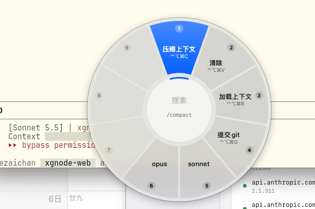

# 速填（QuickInput）

菜单栏文本片段工具：每条片段绑一个全局快捷键，按下即在当前光标处输入对应文本。纯 Swift + AppKit，不依赖 Xcode，只需要 Command Line Tools。



## 构建与安装

```bash
./sign-setup.sh       # 每台机器一次：生成本机签名证书（~/.quickinput-signing/）
./build.sh            # 编译并拼装 build/速填.app
./build.sh install    # 再装到 ~/Applications/速填.app 并启动；开机自启是系统登录项，重装不受影响
```

安装会顺带迁走旧版自启：1.0 的 `com.jiezaichan.sutian`、1.1 的 `com.jiezaichan.quickinput` 两个 LaunchAgent plist 都删掉，原来开着自启的改注册成系统登录项。

**辅助功能授权**：系统按签名身份认人。跑过 `sign-setup.sh` 后用固定证书签名，授权一次以后重编译都不用再授权；没跑就退回 ad-hoc 签名，每次重装都要到「系统设置 → 隐私与安全性 → 辅助功能」删掉旧的「速填」重新勾选。菜单栏「辅助功能权限」一行显示当前状态；没授权时热键照常触发，但打不出字。证书删了重建（删 `~/.quickinput-signing/`）也要重新授权一次。

## 功能

- **片段快捷键**：每条片段可绑一个全局快捷键（键盘组合或鼠标侧键），按下在光标处输入。侧键默认是后退/前进，绑定后只触发片段、不再传给系统
- **输入后回车**：片段勾上后，打完字隔 200ms 自动回车（命令类片段直接执行）
- **搜索面板**：默认 ⌃⌥⌘空格 在鼠标处弹出圆盘，一圈 9 格（从正上方顺时针），鼠标往哪个方向移就选中哪格、单击输入；中间搜索框打字筛选（名称命中优先、再匹配内容），数字键 1~9 直接输入对应格（搜索框里因此打不进 1~9），←→↑↓ 转动选择、↩ 输入、Tab / 滚轮翻页（超过 9 个时）、esc 关闭；快捷键在设置窗口「通用」卡片里改，存在本机设置里，不随片段导入导出
- **授权框填密码**：菜单栏「管理员密码」里存一次（先向系统校验，存登录钥匙串，不随片段导出）。系统授权框（SecurityAgent 弹的「xx 想要进行更改」、钥匙串访问等）出现时旁边贴一条「按 ↩ 自动填入密码」提示，直接按 ↩（或点提示）就输入密码并确认。授权框会锁住焦点，所以靠的是授权框出现期间临时把 ↩ 注册成全局热键，用完即注销；每个授权框只接管一次 ↩。支持两种授权框：SecurityAgent 弹的独立框（终端 `osascript … with administrator privileges`、钥匙串访问等），以及苹果自家 App 自己画的解锁框（系统设置 → 用户与群组 的「正在尝试解锁系统设置」）；后者只认 `com.apple.*` 且密码框在 sheet / 对话框里，网页登录框不会被当成授权框。钥匙串条目的访问控制是「允许本机任何应用访问」：自签证书没有 Team ID，钥匙串只能按二进制哈希认人，不放开的话每次重编译后首次都要输登录密码；代价是以本账号运行的程序都能读到这个密码。启动时只查条目在不在、不取数据，所以启动不弹框。故意不做全自动填，否则任何程序弹授权框都会被放行
- **导入导出**：菜单栏或设置窗口里「导入… / 导出…」，文件格式就是 `snippets.json` 本身。导入可选「合并」（id 相同覆盖、其余追加）或「替换全部」
- **鼠标滚轮加速**：设置窗口「通用」卡片里三项，存在本机设置里，不随片段导入导出
  - **一直加速**：开关，打开后所有鼠标滚轮滚动都加速，不用按键
  - **加速键**：下拉选按住哪个键滚动时临时加速——左 / 右 Ctrl、左 / 右 Option、左 / 右 Cmd、左 / 右 Shift，或「不用」；默认左 Ctrl。只认选中那一侧：选左 Cmd 时右 Cmd 照常当 Cmd 用，两侧同时按着不加速。加速时把这个修饰键从滚动事件里去掉，App 收到的是普通滚动（Ctrl 不会变成终端里的 Ctrl+滚轮，Shift 不会变横向滚动，Cmd 不会触发缩放）；「一直加速」开着时不去掉，修饰键照常透传
  - **加速倍率**：1–15 倍滑杆（整数档），默认 3 倍。滚一格补发成 N 格，微信、终端这类按事件次数滚的 App 也生效
  - 只作用于鼠标滚轮，触控板两指滚动和 Magic Mouse 保持系统原速。靠辅助功能权限拦滚动事件，没授权时「一直加速」旁边显示红字「需要辅助功能权限」；「一直加速」关、加速键选「不用」时不拦事件

## 数据

片段存在 `~/Library/Application Support/速填/snippets.json`（不进仓库），首次运行预置 `/compact` `/clear` `/resume` 三条（⌃⌥⌘ + C / V / R）。

## 代码结构

| 文件 | 内容 |
|---|---|
| `main.swift` | 入口与设计说明（为什么用 Carbon 热键 + CGEvent Unicode 输入） |
| `Store.swift` | 片段模型、读写 snippets.json、预置片段、合并 |
| `HotKeyCenter.swift` | Carbon `RegisterEventHotKey` 注册全局热键（含搜索面板快捷键），记录被占用的键 |
| `Typer.swift` | 等修饰键抬起后用 Unicode 键盘事件打字（不碰剪贴板、不被输入法截胡），可选补回车 |
| `SearchPanel.swift` | 搜索面板（nonactivatingPanel，不抢原 App 的焦点） |
| `Keys.swift` | 键码 ↔ 显示名、修饰键换算 |
| `HotKeyRecorder.swift` | 设置窗口里录快捷键的控件 |
| `SettingsWindow.swift` | 设置窗口 |
| `Transfer.swift` | 导入导出 |
| `AdminPassword.swift` | 管理员密码的钥匙串读写与系统校验 |
| `AuthAssist.swift` | 每秒查一次 SecurityAgent 窗口，期间接管 ↩ 并贴提示 |
| `ScrollBoost.swift` | 鼠标滚轮加速：全局 CGEventTap 把非精确滚动按倍率补发成多次；`BoostKey` 是可选的加速键（keyCode + 左右侧设备标志位） |
| `LoginItem.swift` | 开机自启（SMAppService 系统登录项，见 系统设置 → 通用 → 登录项） |
| `AppDelegate.swift` | 菜单栏图标与菜单 |

改 Bundle ID 要同时改两处：`Resources/Info.plist`、`build.sh` 的 `LABEL`。
